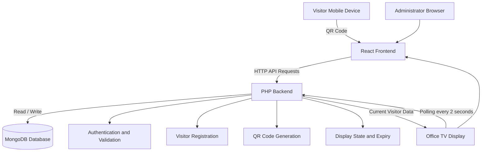

# System Architecture

## 1. Project Overview

QR Visitor Registration and Synchronized TV Display is a web application that allows visitors to register using a QR-based workflow and displays active visitor information on office TV screens.

Administrators can manage the application through a protected dashboard.

## 2. Technology Stack

| Layer | Technology |
|---|---|
| Frontend | React 18 |
| Frontend tooling | Vite |
| Styling | CSS and Tailwind CSS |
| Animation | Framer Motion |
| Icons | Lucide |
| Backend | Core PHP 8.2+ |
| Database | MongoDB |
| PHP dependencies | Composer |
| API | HTTP / JSON |
| Development server | PHP built-in server and Vite |

## 3. Architecture Diagram

## 4. Application Components

### Frontend
- Visitor registration interface.
- QR-based visitor workflow.
- Administrator dashboard.
- TV visitor display.
- API communication and UI state management.

### Backend
- API routing and request handling.
- Visitor registration and validation.
- Administrative authentication.
- QR code generation.
- Image upload handling.
- Current display state and expiry management.

### Database
MongoDB is used as the primary database.

The application data includes visitor information, current display state and administrative information.

## 5. Data Model

The following is a logical data model. Confirm the actual collection names and fields against the backend source code.

### Visitor
- Visitor identifier
- Name
- Phone number
- Photo or image reference
- Registration timestamp
- Other registration metadata

### Display State
- Current visitor reference or display data
- Version
- Update timestamp
- Expiry information

### Administrator
- Administrator identifier
- Authentication information
- Account metadata

## 6. Important Design Decisions

### MongoDB
MongoDB provides document-based storage for visitor records and application state.

### React and Vite
React supports reusable UI components, while Vite provides frontend development and build tooling.

### PHP API
Core PHP handles business logic, validation, authentication and database operations.

### Polling
TV displays poll the API approximately every 2 seconds to detect visitor changes.

### Version-based synchronization
The display uses a version-based update approach so that an unchanged visitor state does not need to be rendered again.

## 7. Security Considerations
- Keep credentials in environment variables.
- Never commit real .env files.
- Validate user input on the backend.
- Protect administrative endpoints.
- Validate uploaded files.
- Use HTTPS in production.
- Apply appropriate session and cookie settings.

## 8. Deployment

See:
- installation.md
- deployment.md
- api.md

These files contain additional setup, deployment and API information.
